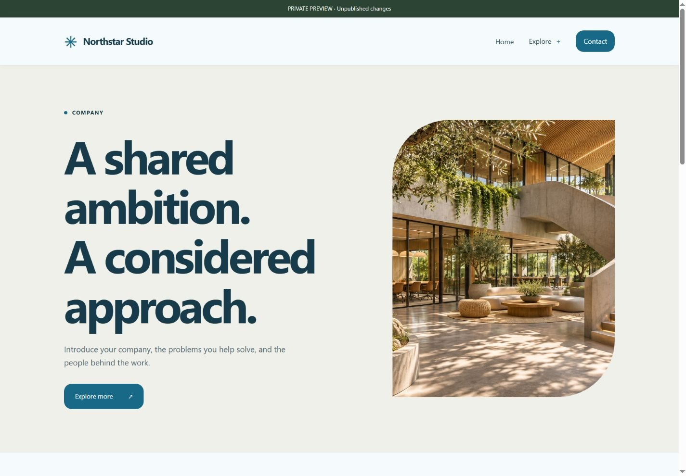

# 1DED Free CMS

**Small by design. Yours by default.**

A free, self-hosted CMS for personal websites, companies, portfolios and independent publishing. Manage pages, shared headers/footers, normal menus and mega menus in a browser, then publish a fixed public snapshot.

**PHP edition 1.0.0 · MIT licensed · 15 subject starters · 8 visual themes · No mandatory cloud service**

**[Download the installable PHP ZIP](https://github.com/saeed-siavash/1ded-free-cms/releases/tag/php-v1.0.0)** · **[Start here: complete user guide](php-edition/docs/USER-GUIDE.md)** · **[All 23 template designs](php-edition/docs/TEMPLATE-GALLERY.md)** · **[Full feature article](php-edition/docs/INTRODUCING-1DED-FREE-CMS.md)**

## Which edition should I install?

| Your hosting | Use |
| --- | --- |
| Compatible cPanel/DirectAdmin with PHP | **PHP 1.0 release ZIP**, uploaded/extracted through File Manager |
| PHP developer checkout | Application source in **php-edition/** |
| Existing older Node installation | Separate legacy Node code at the repository root; its data/backups are incompatible with PHP |

Do not upload the repository's automatic source-code ZIP directly into public_html. Download the attached PHP ZIP from Releases. It has the correct web-root structure and excludes runtime credentials. The stable designation applies to the PHP edition only; the older Node preview remains separate.

## What you can build

Web Hosting, Cloud Hosting, Food, Doctor, Engineer, Business Card, Biography, Resume, Music, Artist, IT, Company, Journal, Press and Blog starters are together in one library. Choose a subject structure, then independently choose a theme, header, footer and navigation design. Artwork, scripts and styles are bundled locally.

| Feature | Included |
| --- | --- |
| Flexible pages | 13 section types, private preview, autosave, revision checks, history and Trash |
| Site navigation | 5 headers, 5 footers, 4 mega-menu styles, nested normal menus, categories and saved links |
| Products/services | Independent pricing per page: 5 layouts, 4 skins, editable plans, features and buttons |
| Media | Image library, descriptive text, decoded public images and privately preserved originals |
| SEO/discovery | Metadata, canonical URLs, social images, sitemap, robots, redirects and local search |
| Publishing | Snapshot publication, release rollback, scheduled publication through cron, static export |
| Contact | Local form inbox; automatic email notifications are not included |
| Accounts | Owner/editor permissions, password changes, authenticator MFA, recovery codes and session revocation |
| Backups | Optional AES-256 ZIP encryption, verified restore, safety backup and interrupted-restore recovery journal |
| Ownership | MIT license, manual File Manager updates, data/media outside replaceable code, no required paid account |

## Install without SSH

1. Enable HTTPS and patched PHP 8.3+ with the required extensions. Prepare an empty MySQL/MariaDB database or use SQLite.
2. Upload/extract the **PHP release ZIP**, including hidden .htaccess files, into a new domain document root or subfolder.
3. Open /install/. Read app/INSTALL-KEY.txt in File Manager and enter it in the installer.
4. Choose private storage **outside every public domain root**, enter database details, select a starter and create the owner account. There is **no default password**.
5. Save the owner emergency code, sign in at /admin/, enable MFA, replace sample content and publish.

Follow the [complete illustrated-design/user documentation](php-edition/docs/USER-GUIDE.md) for cPanel/DirectAdmin steps, menus, pricing, forms, backups, updates and troubleshooting. Hosting must support Apache 2.4 or compatible LiteSpeed rewrite/deny rules; Nginx needs a reviewed equivalent configuration. No Node.js, npm, Composer or SSH is needed to run PHP.

## Update without losing images

Back up first, then replace application code while preserving **app/installed.php**, the external private directory and the database. The PHP ZIP never includes installed.php. Use host maintenance protection during replacement and verify Hosting health before reopening the site. [Full update instructions](php-edition/docs/USER-GUIDE.md#8-update-without-losing-uploads).

## Security and scope

Version 1.0 targets small content websites in the documented hosting profile. It has development tests for installation, account boundaries, MFA, backups, publishing and six restore-interruption states on SQLite/MariaDB. GitHub Actions runs PHP 8.3/8.4 checks. Tests are not an independent audit, a real cPanel deployment, an accessibility certification or a security guarantee.

Signed automatic updates, passkeys, email notifications, broader load/accessibility testing and real shared-host deployment validation remain future work. Contact forms are not for sensitive records, and pricing tables do not process payments. Backups can be encrypted, but automatic pre-restore safety ZIPs and live data remain unencrypted inside private hosting storage. [Read the PHP security policy](php-edition/SECURITY.md).

## Documentation

- [Complete user guide](php-edition/docs/USER-GUIDE.md)
- [Full introduction and feature article](php-edition/docs/INTRODUCING-1DED-FREE-CMS.md)
- [All template screenshots](php-edition/docs/TEMPLATE-GALLERY.md)
- [Hosting and recovery](php-edition/docs/HOSTING.md)
- [MFA and account recovery](php-edition/docs/ACCOUNT-SECURITY.md)
- [Encrypted backups](php-edition/docs/ENCRYPTED-BACKUPS.md)
- [Hosting health](php-edition/docs/HOSTING-HEALTH.md)
- [Developer tests](php-edition/docs/TESTING.md) and [PHP changelog](php-edition/CHANGELOG.md)

Bundled AI-generated artwork is illustrative. Replace it with authentic owner content where appropriate. See the MIT [license](LICENSE). [Contributions](CONTRIBUTING.md) and private vulnerability reports are welcome.
