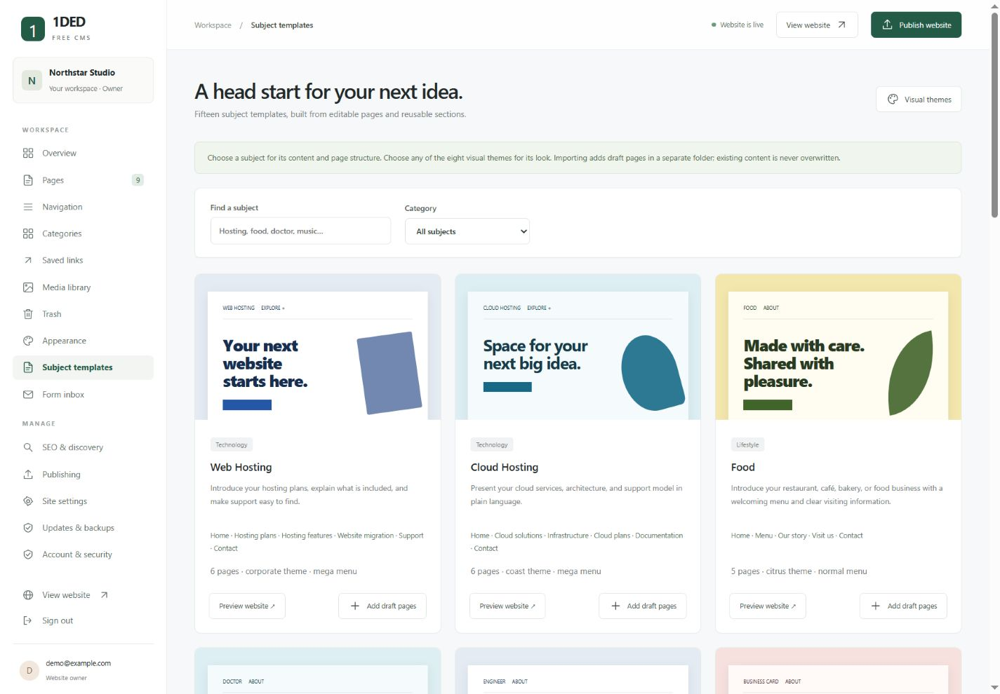

# 1DED Free CMS

**Small by design. Yours by default.**

A free, self-hosted CMS for personal websites, portfolios, small businesses, and independent publishing. Edit in a browser studio, manage shared menus and pages, then publish a portable static website.

**MIT license · Node.js 24+ · 15 subject starters · 8 visual themes · Public beta v0.4.1**

[Download the beta](https://github.com/saeed-siavash/1ded-free-cms/releases) · [Read the full article](docs/INTRODUCING-1DED-FREE-CMS.md) · [See every template](docs/TEMPLATE-GALLERY.md) · [Installation guide](docs/USER-GUIDE.md)

> **Public beta:** suitable for evaluation, development, and carefully managed pilots. Production security hardening and an independent security review are pending. Read [SECURITY.md](SECURITY.md) before a public deployment. No production security certification or search-ranking guarantee is claimed.


## Your website, with room to make it yours

Choose a useful starting structure instead of a blank screen. Write pages, add sections, upload your own images, organize categories, and make the navigation feel right. Keep your content on your own server, and export the published website when you want to move it.

No paid CMS account, mandatory cloud API, external font service, or CDN is required. The application has no npm dependencies to install.

| What you need | What 1DED provides |
| --- | --- |
| A starting point | 15 subject packs and eight independent visual themes |
| Pages you can maintain | 12 section types, formatting toolbar, autosave, history, and trash |
| One consistent website | Shared identity, headers, footers, normal menus, and 2–4 column mega menus |
| Organized content | Categories, tags, posts, projects, services, team content, and automatic collections |
| Images you own | Local media library, optional browser-local WebP optimization, preserved originals |
| Search and discovery | Local site search, metadata, canonical URLs, sitemap, structured identity data, redirects |
| A clear publication process | Private previews, snapshot publishing, scheduling, and publication rollback |
| Portability | Static website ZIP, full backup download, restore tools, and an offline updater |
| Account control | Owner/editor roles, password changes, console recovery, and session revocation |

## Start in minutes

Requires **Node.js 24 or newer** and writable persistent storage.

```sh
git clone https://github.com/saeed-siavash/1ded-free-cms.git
cd 1ded-free-cms
node server.mjs
```

Open **http://127.0.0.1:3000/admin/**. Enter the private installation token printed in the terminal, create your owner account, and select a subject starter. Review the example content before publishing. There are no bundled default credentials.

Alternatively, extract the manifest-bearing ZIP attached to a [release](https://github.com/saeed-siavash/1ded-free-cms/releases) and run the same command. For Docker:

```sh
docker compose up -d --build
docker compose logs cms
```

The admin application needs a Node-capable host or Docker; it cannot run on PHP-only or static-only hosting. Its exported website can run on compatible static hosting. Public installations need HTTPS, secure-cookie/public-origin configuration, and persistent storage. See [deployment](docs/DEPLOYMENT.md). Docker files are supplied, but target-host Docker verification remains necessary.

## Choose one of 15 subject starters

Each pack includes editable pages, sections, suggested categories, and normal or mega navigation. Select one during installation, or import it later into a separate folder as draft pages. URL conflicts reject an import rather than overwrite existing content.

<table>
<tr>
<td width="50%" valign="top">
<h3>Web Hosting</h3>
<a href="docs/images/subjects/web-hosting.jpg"></a>
<p>6 editable pages · corporate · mega menu</p>
</td>
<td width="50%" valign="top">
<h3>Cloud Hosting</h3>
<a href="docs/images/subjects/cloud-hosting.jpg"></a>
<p>6 editable pages · coast · mega menu</p>
</td>
</tr>
<tr>
<td width="50%" valign="top">
<h3>Food</h3>
<a href="docs/images/subjects/food.jpg"></a>
<p>5 editable pages · citrus · normal menu</p>
</td>
<td width="50%" valign="top">
<h3>Doctor</h3>
<a href="docs/images/subjects/doctor.jpg"></a>
<p>5 editable pages · coast · normal menu</p>
</td>
</tr>
<tr>
<td width="50%" valign="top">
<h3>Engineer</h3>
<a href="docs/images/subjects/engineer.jpg"></a>
<p>5 editable pages · corporate · normal menu</p>
</td>
<td width="50%" valign="top">
<h3>Business Card</h3>
<a href="docs/images/subjects/business-card.jpg"></a>
<p>1 editable pages · bloom · normal menu</p>
</td>
</tr>
<tr>
<td width="50%" valign="top">
<h3>Biography</h3>
<a href="docs/images/subjects/biography.jpg"></a>
<p>5 editable pages · lavender · normal menu</p>
</td>
<td width="50%" valign="top">
<h3>Resume</h3>
<a href="docs/images/subjects/resume.jpg"></a>
<p>5 editable pages · minimal · normal menu</p>
</td>
</tr>
<tr>
<td width="50%" valign="top">
<h3>Music</h3>
<a href="docs/images/subjects/music.jpg"></a>
<p>6 editable pages · graphic · normal menu</p>
</td>
<td width="50%" valign="top">
<h3>Artist</h3>
<a href="docs/images/subjects/artist.jpg"></a>
<p>6 editable pages · maximal · normal menu</p>
</td>
</tr>
<tr>
<td width="50%" valign="top">
<h3>IT</h3>
<a href="docs/images/subjects/it.jpg"></a>
<p>6 editable pages · corporate · mega menu</p>
</td>
<td width="50%" valign="top">
<h3>Company</h3>
<a href="docs/images/subjects/company.jpg"></a>
<p>6 editable pages · coast · mega menu</p>
</td>
</tr>
<tr>
<td width="50%" valign="top">
<h3>Journal</h3>
<a href="docs/images/subjects/journal.jpg"></a>
<p>7 editable pages · lavender · normal menu</p>
</td>
<td width="50%" valign="top">
<h3>Press</h3>
<a href="docs/images/subjects/press.jpg"></a>
<p>8 editable pages · corporate · mega menu</p>
</td>
</tr>
<tr>
<td width="50%" valign="top">
<h3>Blog</h3>
<a href="docs/images/subjects/blog.jpg"></a>
<p>6 editable pages · bloom · normal menu</p>
</td>
<td></td>
</tr>
</table>


The examples are website starting points, not hosting provisioning, medical-record software, food ordering, ticket checkout, or audio streaming systems. Replace sample details with accurate original content. [Explore the subject guide](docs/SUBJECT-TEMPLATES.md).

## Give it a visual direction

Subject structure and appearance are separate. Preview any theme using your saved content, choose a recommended palette or retain your current colors, and keep all your pages and images.

<table>
<tr>
<td width="50%" valign="top">
<h3>Minimal</h3>
<a href="docs/images/themes/minimal.jpg"></a>
<p>Quiet confidence. Room to breathe.</p>
</td>
<td width="50%" valign="top">
<h3>Corporate</h3>
<a href="docs/images/themes/corporate.jpg"></a>
<p>Clear, structured, ready for business.</p>
</td>
</tr>
<tr>
<td width="50%" valign="top">
<h3>Graphic</h3>
<a href="docs/images/themes/graphic.jpg"></a>
<p>Bold ideas deserve a bold canvas.</p>
</td>
<td width="50%" valign="top">
<h3>Maximal</h3>
<a href="docs/images/themes/maximal.jpg"></a>
<p>Texture, character, and a playful spirit.</p>
</td>
</tr>
<tr>
<td width="50%" valign="top">
<h3>Coast</h3>
<a href="docs/images/themes/coast.jpg"></a>
<p>Fresh sea blues, airy space, and soft geometry.</p>
</td>
<td width="50%" valign="top">
<h3>Bloom</h3>
<a href="docs/images/themes/bloom.jpg"></a>
<p>Warm coral, blush tones, and a friendly human touch.</p>
</td>
</tr>
<tr>
<td width="50%" valign="top">
<h3>Citrus</h3>
<a href="docs/images/themes/citrus.jpg"></a>
<p>Sunlit yellow, leafy green, and lively simple shapes.</p>
</td>
<td width="50%" valign="top">
<h3>Lavender</h3>
<a href="docs/images/themes/lavender.jpg"></a>
<p>Soft violet, editorial type, and a considered rhythm.</p>
</td>
</tr>
</table>


All themes support normal dropdowns, mixed menus, editable mega-menu groups, sticky headers, mobile disclosures, and page/category destinations. [Template and menu guide](docs/TEMPLATES.md).

## A small studio for everyday editing



Build pages from hero, text, features, image, gallery, timeline, testimonials, FAQ, call-to-action, contact, saved-link, and collection sections. Use the formatting toolbar for readable Markdown, including tables. Page edits autosave; retained versions and recoverable trash provide ways back.

Publish saved changes as a complete snapshot. Drafts stay private. Scheduled publication requires the server to be running; overdue pending jobs run after restart. The form inbox stores general enquiries without a mandatory mail provider. SMTP notifications are not included in this beta.

## Keep your data through updates

Application files and website data have different boundaries. The updater preserves the persistent data directory and .env, creates code/data recovery backups, and checks the incoming release manifest and version. Schema migrations back up the database before applying transactional changes.

```sh
# Stop the CMS and use the same DATA_DIR before update or restore.
node cli.mjs update /path/to/new-release.zip
node cli.mjs backup /path/to/new-backup-folder
node cli.mjs restore /path/to/full-backup.zip
```

Use the attached release asset for updates, not GitHub's automatically generated source ZIP. Keep a private backup away from the installation. Manifest hashes detect corruption; signed release authentication is still planned. Docker updates must retain the same persistent data volume. [Read the upgrade guide](docs/UPGRADING.md), including the first upgrade from 0.1.0.

## Documentation

- [Full project article](docs/INTRODUCING-1DED-FREE-CMS.md)
- [Installation and user guide](docs/USER-GUIDE.md)
- [All 23 template screenshots](docs/TEMPLATE-GALLERY.md)
- [Subject templates and safe imports](docs/SUBJECT-TEMPLATES.md)
- [Visual themes and menu controls](docs/TEMPLATES.md)
- [Deployment](docs/DEPLOYMENT.md), [upgrades and recovery](docs/UPGRADING.md), [architecture](docs/ARCHITECTURE.md)
- [Security status](SECURITY.md), [release-readiness roadmap](docs/RELEASE-READINESS.md), [changelog](CHANGELOG.md)

## Test and contribute

```sh
node --test
```

The suite covers authentication flows, role boundaries, draft privacy, content validation, publishing, imports, backup restoration, legacy data migration, update preservation, and the public asset budget. Eighteen tests passed while preparing this release. Tests are useful evidence, not a substitute for an independent security review.

Help improve the project through reproducible bug reports, documentation, accessibility work, tests, and reviewed contributions. Report security issues privately through the repository's security reporting channel rather than public issues. [Contributing guide](CONTRIBUTING.md).

Released under the [MIT license](LICENSE). **Your content. Your hosting. Your next chapter.**
