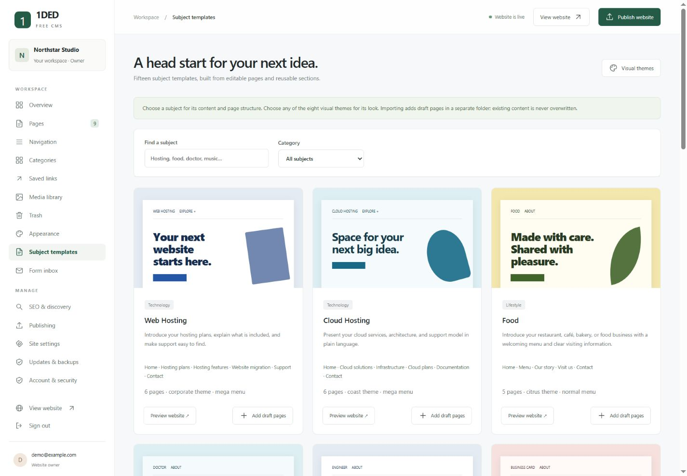

# Subject templates

1DED Free CMS includes **15 subject starter packs** and **8 visual themes**. A subject pack supplies editable pages, section layouts, categories, and navigation. A visual theme supplies colors, typography, and decorative styling. You can combine them without recreating your content.

| Subject | Included structure | Recommended look |
| --- | --- | --- |
| Web Hosting | Home, plans, features, migration, support, contact; editable plan comparison | Corporate + mega menu |
| Cloud Hosting | Home, solutions, infrastructure, plans, documentation, contact | Coast + mega menu |
| Food | Home, menu, story, visit, contact; editable menu table | Citrus + centered home |
| Doctor | Home, consultations, professional profile, patient information, contact | Coast + normal menu |
| Engineer | Home, services, projects, profile, contact | Corporate + split home |
| Business Card | One compact page with introduction, skills, and contact | Bloom + card layout |
| Biography | Home, story, timeline, life/work, contact | Lavender + editorial layout |
| Resume | Home, experience, projects, education, contact | Minimal + resume layout |
| Music | Home, releases, live dates, about, booking, contact | Graphic + centered home |
| Artist | Home, work, about, exhibitions, commissions, contact | Maximal + editorial layout |
| IT | Home, services, solutions, approach, support, contact | Corporate + mega menu |
| Company | Home, about, services, work, team, contact | Coast + mega menu |
| Journal | Home, about, contributors, submissions, contact, two sample articles | Lavender + article collection |
| Press | Home, newsroom, media kit, about, editorial policy, contact, two sample articles | Corporate + mega menu |
| Blog | Home, about author, start here, contact, two sample articles | Bloom + article collection |

## Start a new installation

The installation wizard's **Website starter** selector includes all 15 subjects. The selected pack initializes the website's page structure, navigation, suggested appearance, and categories. Enter your own website name and public URL. Review all starter content before your first publication.

The server still supports the original `business`, `personal`, and `portfolio` preset values for compatibility with older installation clients. Those legacy values retain their original three-page behavior.

## Preview before importing

The owner can open **Subject templates** in the admin. Search by subject or filter by group. Choose **Preview website** to inspect a complete private example using the current site identity and the pack's recommended look.

Preview navigation stays within that pack, including its detail pages and sample articles. Previews require a signed-in session, are marked noindex, and do not save pages or appearance settings. An optional `theme` query can select another bundled visual theme for a preview.

## Add a pack to an existing website

1. Select **Add draft pages**.
2. Choose a unique destination folder, such as `food` or `my-portfolio`.
3. Optionally add a navigation group. By default, global colors and typography stay unchanged.
4. Import. All imported pages are private drafts. Existing pages and uploads are not overwritten.
5. Edit the imported pages, replace example details, add your own images, and review the private previews.
6. Under Recently added templates, select **Include in next publish** when ready. This changes only that import's remaining draft pages to publication-eligible pages.
7. Publish the website to make eligible pages public.

For example, the Food pack imported under `food` produces `/food/`, `/food/menu/`, `/food/our-story/`, `/food/visit/`, and `/food/contact/`. A URL conflict rejects the import and asks for another folder name. Nothing is partially imported.

Categories with matching slugs are reused without changing their names or descriptions. Other pack categories are added. Imports are recorded so the owner can find and manage the resulting pages. Only owners can import packs or activate an import's pages.

## Edit the layouts and sections

Each page has a **Page layout** setting: site default, split, centered, card, resume, or editorial. The pack homepages select a suitable starting layout; detail pages use a readable split layout. Change this under Page & SEO.

The new **collection** section automatically displays published posts, projects, services, team members, or pages. Choose a content type, an optional category filter, and a maximum item count. Private previews also show drafts to signed-in editors. Public builds omit drafts and resolve collection links to actual published URLs.

Plan comparisons, menus, and event schedules use editable Markdown tables. Timelines use timeline sections. Work and release selections use gallery sections; upload your own artwork or photographs. Empty gallery slots are visibly marked as image placeholders.

Normal menus, mega menus, header behavior, footer links, icons, and page/category destinations remain owner-manageable under Navigation. See [TEMPLATES.md](TEMPLATES.md).

## Replace examples with real information

Starter text is explicitly illustrative. No real credentials, reviews, awards, prices, uptime guarantees, or professional outcomes are invented. Sample articles must be replaced with original, verified writing before publication. Replace example table entries, author names, dates, and image slots.

These packs create **websites**, not the underlying specialist business software:

- Hosting packs do not provision servers, register domains, or process billing.
- The Doctor pack is a public-information website, not a patient portal or medical-record system. Its general enquiry form must not be used for confidential clinical information. Add only verified professional details and have clinical content reviewed appropriately.
- Food reservations, payments, delivery ordering, and booking management are not included.
- Music releases and live pages provide editable content and links; audio streaming, ticket checkout, and music-file uploads are not included.
- Resume and biography packs require real qualifications and experience. PDF generation is not included.
- Journal, press, and blog packs do not import outside news or copyrighted articles. Verify facts, permissions, attribution, and publishing rights.

No external assets, accounts, fonts, or CDNs are required. Optional owner-supplied links can point to existing services.

## Upgrade compatibility

Version 0.4.0 adds the library and content fields without changing the existing SQL schema. An update does not install any subject pack automatically or change the current website identity. Existing pages, images, and menu settings remain in the persistent data directory. Follow [UPGRADING.md](UPGRADING.md).

This remains a beta release. The template library is not a substitute for the pending production security hardening and independent security review.
