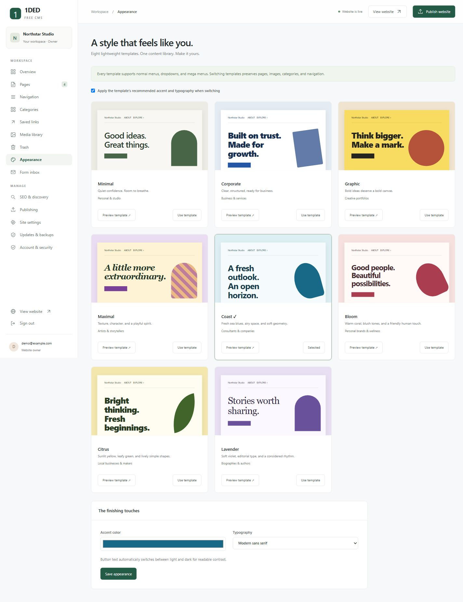
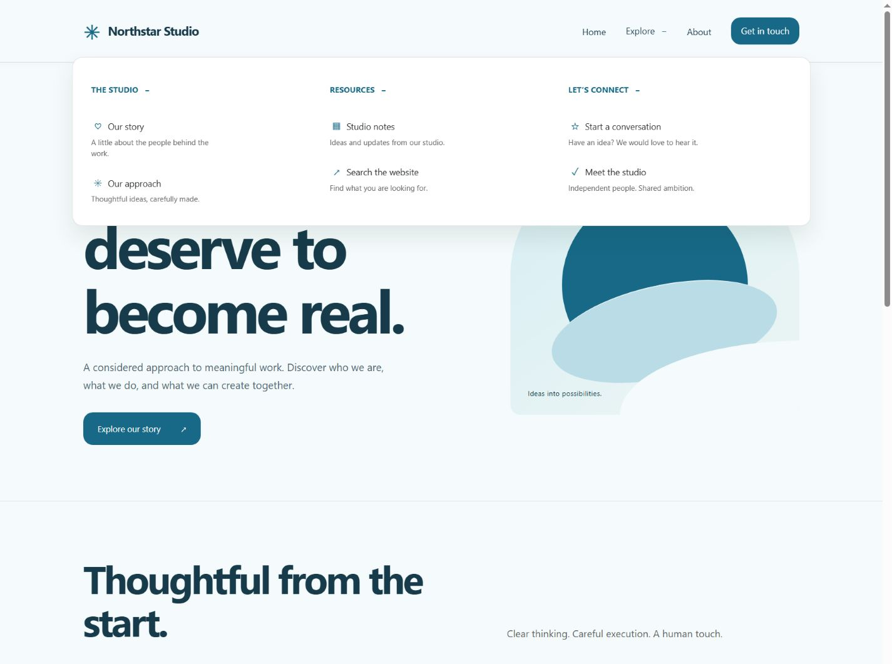

# Templates and navigation

For purpose-specific pages and content, see the [15 subject templates](SUBJECT-TEMPLATES.md). These combine with the eight visual themes below.

All eight templates use the same content model. Changing presentation never recreates or deletes your pages, uploaded images, categories, saved links, or menus. These are coordinated visual templates over the same flexible page sections.

| Template | Direction | Suggested use |
| --- | --- | --- |
| Minimal | Cream, muted green, restrained typography | Personal sites and studios |
| Corporate | Clear blue, white, structured headings | Companies and professional services |
| Graphic | Strong color and bold type | Portfolios and creative businesses |
| Maximal | Expressive patterns and editorial shapes | Artists and storytellers |
| Coast | Airy blue, rounded forms, soft sea colors | Consultants and companies |
| Bloom | Warm coral and blush, friendly cards | Personal brands and wellness |
| Citrus | Sunlit yellow, leafy green, lively geometry | Local businesses and makers |
| Lavender | Soft violet and editorial serif headings | Biographies and authors |

## Choose and preview

The owner (the CMS administrator) manages templates under **Appearance**. Select **Preview template** to view your saved homepage with that template in a private, authenticated preview. This changes no stored settings and publishes nothing.

By default, switching applies the template's recommended accent and typography. Uncheck **Apply the template's recommended accent and typography** to preserve your current choices. Customize the accent and font afterward under The finishing touches.

Template changes are saved as draft site settings. Publish the website when ready to make them public. Page editors can preview saved content but cannot change global site settings through the API.

There are no external fonts, CDN scripts, images, or tracking services required. Decorative graphics use CSS. System fonts keep installation and loading small. Button text chooses light or dark ink based on the accent's contrast.

## Normal menus and mega menus

Go to **Navigation** and select the default header style:

- **Automatic:** preserves the original behavior; groups with nested columns become mega menus.
- **Normal menus and dropdowns:** compact dropdown panels, with expandable nested groups.
- **Mega menus:** wider panels using 2–4 columns.

An individual top-level group's **Submenu layout** can override the default. This lets one header contain both compact dropdowns and a mega menu. Items without children remain ordinary links.

To create a mega menu:

1. Add a top-level item, such as Explore.
2. Choose Mega menu for its layout, or use the site's mega default.
3. Choose 2, 3, or 4 columns.
4. Add child groups as column headings, then add links beneath each heading. A flat list of child links is also supported.
5. Save navigation, inspect a private page preview, and publish when ready.

For each entry, manage its label, page/category destination or custom URL, description, icon, button appearance, new-tab behavior, and nofollow flag. Selected page/category destinations are references rather than copied URLs. They follow URL changes; assigned category entries prevent accidental category deletion.

Use up/down controls to reorder entries and Duplicate to copy a group with all its children. Footer navigation has its own editable link tree.

## Header and mobile controls

The owner can enable a sticky header, choose right or centered desktop navigation, and add the built-in website-search link. All templates share these controls.

At tablet/mobile widths (1000 px and below), normal and mega menus use the Menu button and expandable groups. Controls use native disclosure semantics, visible keyboard focus, and a single-column layout. Escape closes menus; clicking outside the header closes open header menus. Only one top-level submenu opens at once.

Use concise navigation labels. Very large link trees are technically supported up to the model limit but are harder for visitors to use. Organize them into a few meaningful groups and check mobile navigation before publishing.

## Updating an existing installation

Version 0.3.0 has additive settings with backward-compatible defaults and uses the existing database schema. Existing sites stay on their chosen template and automatic menu layout. Installing this release does not change the selected template or public content by itself.

Follow [UPGRADING.md](UPGRADING.md) to preserve the same data directory or Docker volume. The template assets are application files; custom content and uploaded images remain in the persistent data directory.

This is still a beta release. New presentation features do not replace the pending production security hardening and independent review.
