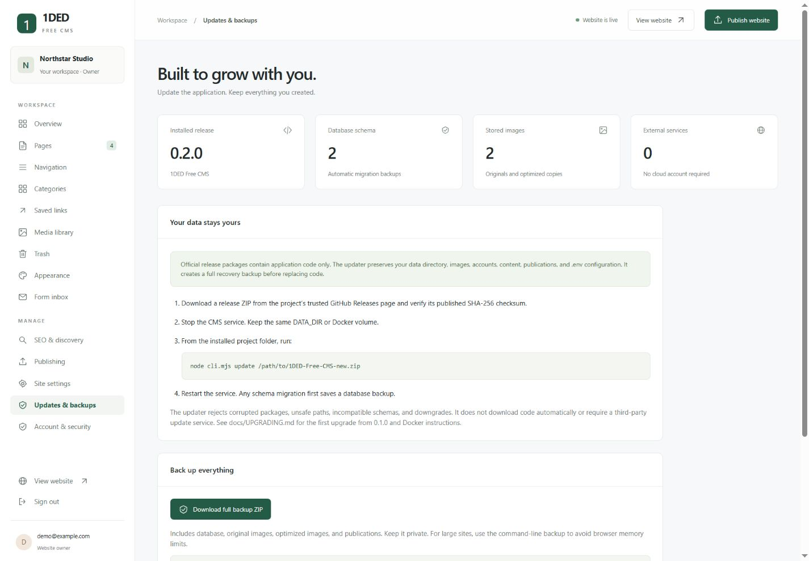

# Updating 1DED Free CMS without losing content



## The rule: application files and website data are different

Release ZIPs contain application code, templates, tests, and documentation. They never contain your live database, uploaded images, accounts, `.env`, or site publications. The updater accepts only application paths listed in the release manifest. It refuses an update package that tries to include `data/` or `.env`.

Keep one stable **DATA_DIR** for the lifetime of an installation. By default this is the `data/` folder beside server.mjs. You can use an absolute directory outside the application, such as `/var/lib/1ded`, for even clearer separation. Docker uses the persistent `cms-data` volume.

Do not uninstall the CMS, delete its data folder, or create a new volume to perform an update. Content and visual settings should be changed in the CMS; direct edits to application templates are code customizations and may be overwritten by a release.

## Normal update (version 0.2.0 and later)

1. Download the official release ZIP from the repository owner's GitHub Releases page. Download its `.sha256` file and verify the checksum. The CMS has no dependency on a central update server.
2. Stop the CMS service. In a terminal development install, use Ctrl+C. With systemd, stop the service.
3. In the installed application folder, with the same DATA_DIR environment setting as the service, run:

```sh
node cli.mjs update /path/to/1DED-Free-CMS-NEW-VERSION.zip
```

4. The command validates the archive and release compatibility, refuses a downgrade, backs up the **entire data directory and current application code**, then replaces application files. It preserves `.env` and your data directory.
5. Restart the service. Before a database schema migration, the CMS saves a consistent pre-migration database under `DATA_DIR/migration-backups/`. The migration runs in a transaction. A newer, unsupported schema is refused rather than downgraded.
6. Sign in and check pages, categories, menus, images, and the inbox. The previously published website remains the active snapshot until you intentionally publish.

The command prints its recovery backup location. Keep that backup until you have verified the installation. Allow disk space for a full data copy plus the staged application. If validation or backup fails, code replacement does not begin. If a code-copy step fails, the updater attempts to restore the previous code and reports the recovery path.

**This process protects against normal update failures; a backup on the same disk is not protection against disk failure. Keep a separate off-server copy.**

## First upgrade from 0.1.0

Version 0.1.0 did not include an update command. Use the updater included in the newly downloaded release to upgrade that existing installation:

1. Download the **latest release ZIP** and extract it to a separate temporary application folder.
2. Stop the old installation.
3. Run the new release's CLI with the old installation as its target:

```sh
node /path/to/extracted-release/cli.mjs update /path/to/1DED-Free-CMS-v0.4.0.zip --target /path/to/installed-cms
```

Windows example:

```powershell
node "C:\Downloads\1ded-new\cli.mjs" update "C:\Downloads\1DED-Free-CMS-v0.4.0.zip" --target "C:\Sites\1ded-free-cms"
```

If using a custom data directory, export the same DATA_DIR first. The target must be the existing application directory, not its data directory. Restart the updated existing installation afterward.

The upgrade tests exercise legacy records, account hashes, upload bytes, configuration preservation, corrupt packages, and backup restoration. Existing 0.1.0 content does not need to be recreated or re-uploaded.

## Docker updates

Do not use the in-container code updater as a permanent image update; a container rebuild would replace those changes.

1. Download a full backup from **Updates & backups**, and store it outside the container.
2. Stop the service and replace the application source with the new release (or switch to the new source checkout).
3. Keep the same Compose project name and volume. From the same deployment folder:

```sh
docker compose up -d --build
```

The `cms-data` volume is reattached to the new container and migrations run against the existing database. Never use `docker compose down -v` for an update. If changing deployment folder names, explicitly retain the original named volume; Compose otherwise may select a new project volume and appear to have an empty installation.

Docker instructions are supplied for deployment but were not executed in the Windows development environment.

## Full backups and restoration

Download **Updates & backups → Download full backup ZIP**, or run:

```sh
node cli.mjs backup /path/to/new-backup-folder
```

A full backup includes the database, uploads (including preserved originals), optimized copies, and publications. The old database-only download is not a full backup.

To restore:

```sh
# Stop the server first and use the same DATA_DIR.
node cli.mjs restore /path/to/1ded-full-backup.zip
# Or restore a full backup directory:
node cli.mjs restore /path/to/full-backup-folder
```

Restoration validates database integrity and checks that recorded uploads and the current publication are present. It stages the restored data, saves a safety backup of the existing data, then switches directories. Restored sessions are revoked; sign in again after restarting. A schema newer than the installed application is refused.

If a restored page URL conflicts with another page in the trash, resolve the URL conflict before restoring that page. Publication rollback is a separate operation that changes only the public snapshot, not your working drafts.

## Recovery after a failed migration

Stop the service. Preserve the failed installation and consult the error log. The update safety backup contains `application/` plus the original complete data snapshot. Restore matching code and data together into separate directories, point DATA_DIR at that restored data, and start the old application. Do not run an older application directly against a newer database. Do not overwrite the only copy of your uploads.

`node cli.mjs doctor` reports database integrity, installed schema, upload count, and missing media. Run it against a stopped installation when investigating a failure.

## Maintainer release checklist

1. Update package.json version and CHANGELOG.md. Add transactional migrations for schema changes; never edit a previously shipped migration destructively.
2. Run `node --test` and check editing, publishing, backups, and responsive layouts in the browser.
3. Generate the release manifest and archive:

```sh
node cli.mjs release /path/to/1DED-Free-CMS-vX.Y.Z.zip
```

4. Generate a SHA-256 checksum and attach both ZIP and checksum to a GitHub Release. The updater requires **this manifest-bearing release asset**, not GitHub's automatically generated source ZIP.
5. Test an upgrade from the previous release using a disposable copy of real-world-shaped data. Confirm that originals, media URLs, content, accounts, and published pages remain intact.

Manifest hashes detect corruption and unexpected file changes; they do **not** authenticate a malicious replacement manifest. Obtain release assets and checksums through the repository's trusted release channel. No arbitrary remote URL is fetched or executed by the updater.

Version 0.3.0 adds presentation settings with backward-compatible defaults and does not change database schema 2. Existing pages, media paths, and saved categories remain unchanged. Existing menu behavior uses the automatic mode until the owner chooses a new layout.

Version 0.4.0 adds the subject library, page layout fields, and a content-collection section. No subject pack is installed during an upgrade. Owners explicitly import new draft pages into a unique folder; existing pages, images, identities, and navigation are preserved unless an owner selects an optional appearance/menu change. As always, application downgrades require matching code and backed-up data.
