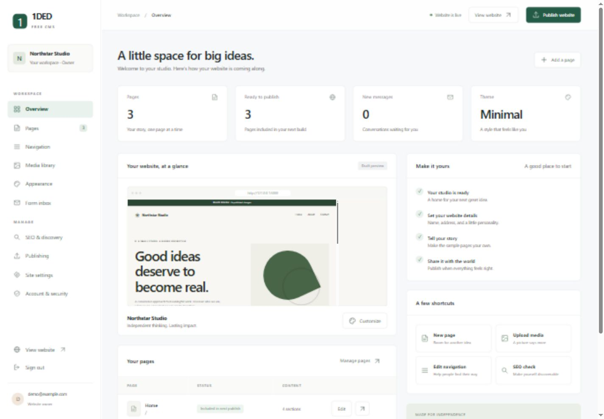

# 1DED Free CMS

**Small by design. Yours by default.**

A free, self-hosted CMS for personal websites, biographies, portfolios, and small businesses. Edit in a friendly browser studio, then publish a complete static website. Your public pages keep working independently of the editor.

**Version 0.4.1 — illustrated public beta.** A working application, not a production security certification. Review the deployment guide and test your installation before using it for important customer data.



## A home for your website

- Browser-based installation wizard; no default accounts or passwords.
- Shared site identity, header navigation, footer navigation, logo, favicon, and social links.
- Pages, blog posts, projects, services, and team content with categories, tags, summaries, and authors.
- Category archives, blog index, saved-link directories, internal link checks, and local website search.
- Page creation, duplication, URL editing, private previews, recoverable trash, autosave, and 50 saved versions per page.
- Twelve section types: hero, text, features, image, gallery, timeline, testimonials, FAQ, call to action, contact, categorized links, and content collections.
- Reorder, duplicate, hide, and remove sections. Reorder collection items.
- Eight coordinated templates: **Minimal, Corporate, Graphic, Maximal, Coast, Bloom, Citrus, Lavender**.
- Authenticated previews of every template using your own saved content, without applying changes.
- Optional recommended palettes, custom accent colors, and readable button text contrast.
- Fifteen subject packs: Web Hosting, Cloud Hosting, Food, Doctor, Engineer, Business Card, Biography, Resume, Music, Artist, IT, Company, Journal, Press, and Blog.
- Select a subject during installation, or preview/import a pack later as separate draft pages without overwriting existing content.
- Split, centered, card, resume, and editorial page layouts; automatic collection sections for categorized content.
- Accent colors, three system font families, language, and RTL direction.
- Three-level menu editor with explicit normal/mega defaults and per-group overrides.
- Owner-managed 2–4 column mega menus, icons, descriptions, category links, button links, link flags, ordering, and duplication.
- Optional sticky header, centered navigation, website-search link, and expandable mobile groups.
- Raster media library with names, folder labels, alt text, search, and reusable paths.
- Optional browser-local resizing and WebP optimization; original files are preserved.
- Text-formatting toolbar for bold, italic, links, lists, quotes, code, and tables.
- Built-in contact inbox, validation, honeypot, and rate limits.
- SEO metadata, canonicals, sitemap, robots.txt, social cards, identity JSON-LD, and useful content warnings.
- Redirects on URL changes; proper HTTP 404s.
- Snapshot publishing, scheduled publication, history, and rollback without overwriting drafts.
- Downloadable static ZIP, full backup ZIP, and a validated backup restore command.
- Offline release updater with checksums, code/data recovery backups, schema migrations, and downgrade protection.
- Owner/editor roles, password changes, session revocation, and console password recovery.
- No package installation, build step, third-party scripts, analytics, or cloud account required.

## Install in two minutes

Requires **Node.js 24 or newer**, with the built-in `node:sqlite` module, and a writable persistent disk. Node.js includes the database runtime; no database server is needed.

1. Download or clone this repository.
2. Open a terminal in the project folder.
3. Run:

```sh
node server.mjs
```

4. Open **http://127.0.0.1:3000/admin/**.
5. Copy the private installation token printed in the server terminal into the wizard.
6. Enter your site name, public URL, owner email, and a password of at least 12 characters.
7. Sign in, edit your pages, and select **Publish website**.

Installation closes after the first owner is created. There are no bundled credentials. On an unconfigured installation, restarting the server generates a new token unless `SETUP_TOKEN` is set.

If npm is available, `npm start` and `npm test` also work. npm is not required.

## Docker

```sh
docker compose up -d --build
docker compose logs cms
```

Open **http://localhost:3000/admin/** and use the token from the logs. This localhost install uses an HTTP cookie; production must use HTTPS.

For a public deployment, copy `.env.example` to `.env`, set your exact `PUBLIC_ORIGIN` and `COOKIE_SECURE=true`, and put a TLS reverse proxy in front of port 3000. See [deployment](DEPLOYMENT.md).

The Compose volume `cms-data` stores your database, uploads, and publications. Do not remove it when updating the application.

## Typical workflow

1. **Site settings:** add your identity, domain, contact details, logo, and footer.
2. **Appearance:** preview and choose one of eight templates. Apply its recommended palette or keep your existing accent and typography.
3. **Pages:** edit the starter pages or add new ones. Select a section to edit its content. Buttons move sections up/down; headings support line breaks.
4. **Navigation:** choose a normal or mega menu default, override individual top-level groups, and add links/columns. Choose pages or category archives from the destination list so links follow URL changes.
5. **SEO & discovery:** review warnings and add page-specific titles/descriptions.
6. **Preview:** inspect the saved draft. Preview links require a signed-in session.
7. **Publish:** make all saved changes live together.

Saving does **not** publish. “Included in next publish” means the page is eligible for publication; it does not mean the latest edits are already live. Draft pages are omitted from generated public output. Page content and metadata autosave after a short pause. You can also use **Save page** or Ctrl/Cmd+S. Shared site settings and navigation still require explicit saving. If another session changed the same page, autosave pauses with an error instead of overwriting newer work.

## Static hosting and portability

After publishing, go to **Publishing → Download static website ZIP**. Extract it and upload the contents to a static host. It contains HTML, CSS, JavaScript, referenced images, a sitemap, robots.txt, a 404 page, and redirect configuration examples.

- The CMS itself needs a Node-capable server or Docker host. It cannot run on GitHub Pages or PHP-only shared hosting.
- The **exported website** can run on static hosting, including GitHub Pages when published at a root custom domain. Subdirectory hosting such as `/repository/` is not supported in this release.
- Contact forms need a live HTTPS endpoint. Set **Form endpoint** before exporting. Without one, the exported form points to `/api/contact`, which exists only on the CMS server.
- `_redirects` is recognized by some static hosts. Nginx rules are included separately. Apply the appropriate rules for your host; GitHub Pages does not provide arbitrary server-side 301 redirects.
- Theme changes preserve content because every theme uses the same page schema.

## Accounts and recovery

The owner can manage settings, publish, restore publications, export, back up, and add editors. Editors can manage pages, images, and messages, and change their own password. Share temporary passwords securely and ask editors to change them.

Change your password under **Account & security**. This signs out every session for that account.

If locked out, use the server console:

```sh
node cli.mjs reset-password owner@example.com
```

The command prompts privately for the new password and confirmation. For Docker:

```sh
docker compose exec cms node cli.mjs reset-password owner@example.com
```

There is no email-based password recovery in this version. Server access is required.

## Backups and updates

```sh
node cli.mjs backup
```

This creates a new timestamped full backup in `1ded-backups/` beside DATA_DIR. You can also download a full backup ZIP from **Updates & backups**. Original images, optimized images, database records, and publications are included. For a quiet filesystem backup, stop the application and copy the entire DATA_DIR.

To restore, stop the app and run `node cli.mjs restore /path/to/full-backup.zip` with the same DATA_DIR. The tool validates the backup and saves the previous data before restoring. Test restoration on a separate instance first. Keep backups private: they contain password hashes, contact messages, and drafts.

To update, stop the app and run `node cli.mjs update /path/to/new-release.zip`. The tool backs up before replacing application code and preserves data, uploads, and .env. Restart to run backed-up schema migrations. For the first update from 0.1.0, run the new release's CLI with `--target` pointing at the old installation. See the step-by-step [upgrade guide](UPGRADING.md), including Docker volume preservation.

## Tests

```sh
node --test
```

The suite exercises validation, escaping, password hashing, installation, roles, CSRF/origin protection, draft isolation, publishing, rollback, forms, redirects, private previews, archives, categories, link references, history, trash, scheduling, backup ZIP restoration, legacy migrations, update preservation, invalid archives, downgrade rejection, session revocation, and persistence.

See the [subject-template guide](SUBJECT-TEMPLATES.md) for the 15 packs and safe import workflow, and the [template and menu guide](TEMPLATES.md) for visual choices and navigation controls. All public CSS and JavaScript remain below 50 KB uncompressed in the automated asset-budget check.

## Scope of this release

This is deliberately a focused first release:

- Contact messages are stored in the inbox. There are **no SMTP notifications**, delivery retries, or newsletter subscriptions. An external form endpoint can supply email delivery.
- Optional browser-local optimization creates one smaller WebP copy up to 1920 px and keeps the original. Multi-size responsive image generation and server-side image processing are not included.
- Six built-in text-symbol icons are provided. **Font Awesome is not bundled**; a licensed icon-package integration is future work.
- Text formatting uses a Markdown toolbar with saved-draft preview. It is not a full WYSIWYG HTML editor; raw HTML remains safely escaped.
- No multilingual content variants, plugins, commerce, or multisite tenancy. Scheduled publication requires the server to stay running; overdue pending jobs run after restart.
- Content types share the same flexible section editor. Posts gain a public blog index; categories gain archives; collection sections display matching content automatically. There are no advanced relational custom-field schemas yet.
- No MFA, mail-based account verification, or automated password reset email.
- This version targets small sites on a **single server process**. There is no distributed publishing lock or concurrent-edit merge UI. Revision checks reject stale page/settings saves; reload before trying again.
- Media URLs are public if known. Do not upload confidential material. Unreferenced images are omitted from static exports.
- ZIP export is assembled in memory. Use filesystem deployment for very large sites.
- Publications and media are retained; monitor disk usage and back up before manual cleanup.

Next priorities include email integration, WYSIWYG editing, multilingual content, richer custom fields, image variants, assistive-technology testing, and an independent security review.

## Project layout

```text
server.mjs           HTTP server and protected API
cli.mjs              Safe upgrades, full backup/restore, recovery, diagnostics
lib/model.mjs        Content schema, defaults, and validation
lib/store.mjs        SQLite storage and audit trail
lib/migrations.mjs   Versioned migrations and database safety backups
lib/maintenance.mjs Offline update, integrity checks, full backup/restore
lib/content.mjs     Categories, saved links, collections, generated archives
lib/starters.mjs    Fifteen subject packs, content structures, and menu plans
lib/content-api.mjs Content/history/trash/backup endpoints
lib/richtext.mjs    Safe formatted-text renderer
lib/security.mjs     Passwords, session tokens, and rate limits
lib/render.mjs       Static renderer and snapshot publishing
lib/zip.mjs          Dependency-free ZIP export
public/              Admin UI, four theme styles, navigation script
test/                Node test runner integration tests
docs/                Deployment and architecture notes
data/                Local runtime state (ignored by Git)
```

## Contribute

See [CONTRIBUTING.md](../CONTRIBUTING.md), [SECURITY.md](../SECURITY.md), and [architecture](ARCHITECTURE.md). Runtime data is never part of a source contribution. The project is released under the [MIT license](../LICENSE).

Built for people who want a small website they can understand, own, and take with them.
