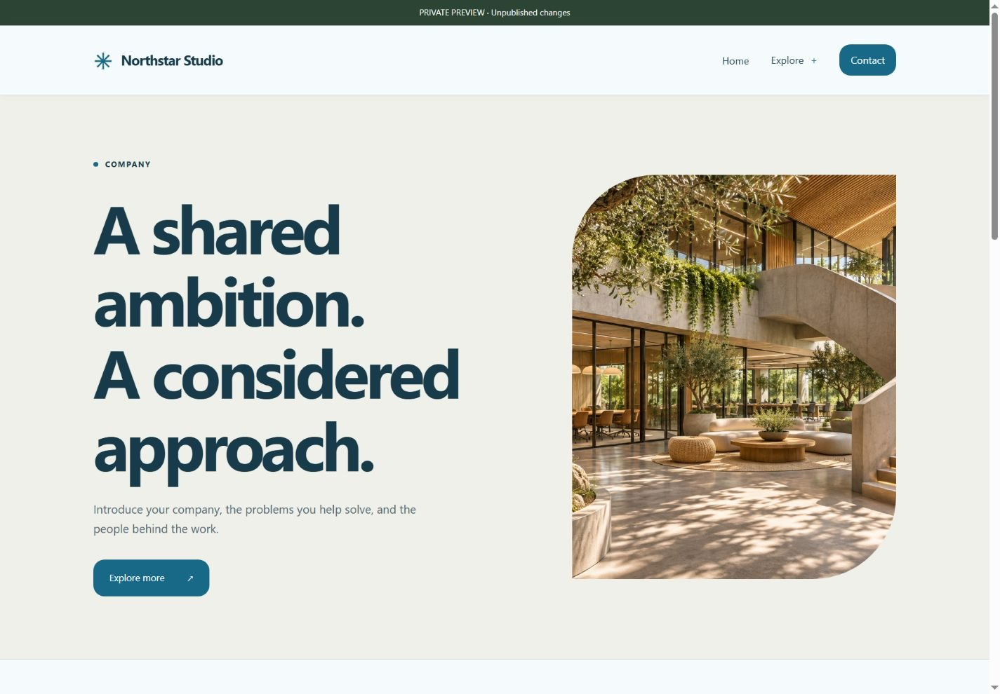

# 1DED Free CMS: a small website, fully your own

**Version 1.0 · PHP edition · MIT licensed · Self-hosted**

A small website should be easy to maintain. You should not have to copy the same header across twenty pages, rebuild a menu by hand, or connect several paid services just to publish a biography or business homepage. 1DED Free CMS brings those jobs into one local browser studio and publishes a fixed public snapshot when you are ready.

The PHP edition is designed for compatible ordinary hosting accounts. Upload the release ZIP, create a database or choose SQLite, run the guided browser installer and create your own account. There is no default admin password, no compulsory cloud account and no npm/Composer installation step for site owners.

## A useful starting point for different websites

The unified template library contains **Web Hosting, Cloud Hosting, Food, Doctor, Engineer, Business Card, Biography, Resume, Music, Artist, IT, Company, Journal, Press and Blog** starters. Eight visual themes let you choose a different presentation independently of the subject. Each starter bundles local illustrative artwork and editable example pages.

See **[all 23 designs together, with screenshots](TEMPLATE-GALLERY.md)**. The gallery records the shared template designs; the PHP and Node renderers can have small differences. Use previews in your installation to assess the final result.

## Shared navigation without repeated editing

Manage the site name, logo, header, footer and menus centrally. Choose among five headers, five footers and four mega-menu styles. Build ordinary dropdowns or larger grouped menus, choose page/category/link destinations and keep common navigation consistent across the published website.

## Pages that can grow with the project

Compose pages from thirteen section types. Mix photographs, text, galleries, FAQs, services, timelines, testimonials and calls to action. Organize posts and other content using categories and tags; keep reusable destinations in Saved links. Private previews, revision conflict checks, history and recoverable trash help during everyday editing.

Products and services can each have independent pricing sections. Five layouts and four skins cover cards, comparisons and other arrangements with editable amounts, billing labels, feature rows, badges and buttons. Pricing is presentation, not payment processing.

## Local media and deliberate publication

Uploaded images are decoded and re-encoded for public use; source originals are privately preserved. Bundle artwork stays local, so the visual design does not depend on an external image service. Replace sample images and claims with genuine business content.

Draft edits stay separate from the published snapshot. Publish when ready, roll back to a previous publication, or schedule publication through a hosting cron job. Export the public website as static files when you want to move the result; exported contact forms still need a live endpoint.

## Search, SEO and contact messages

The CMS provides page metadata, canonical URLs, social images, sitemap, robots rules, redirects, search data and checks for common editorial issues. These help maintain a useful website; they do not promise search rankings. Contact submissions are saved locally in Form inbox. Automatic email notification is not included, so the owner should check the inbox regularly.

## Account protection and ownership

Create an owner account and optional content editors. Use unique passwords, authenticator MFA, single-use recovery codes and session controls. Sensitive operations require fresh owner verification and an MFA factor when enabled. The installer also gives the owner a separate emergency recovery code that works without SSH.

Full backups include content, accounts, messages, history and originals. Choose an AES-256 encrypted ZIP with a separate passphrase for off-host storage. Restore validates the archive, makes a safety copy, revokes sessions and uses a recovery journal for interrupted file swaps. Plain safety backups remain in private storage; encryption does not protect live data from a compromised hosting account.

## Updates that respect installed websites

Application code is separate from uploaded originals, images and private data. An update replaces code while preserving app/installed.php, the external private directory and the database. A local file manifest helps spot incomplete or changed packages. Updates are manual through File Manager; signed automatic updates are future work. Always back up and test first.

## What version 1.0 promises—and what it does not

This release focuses on small content websites in the documented PHP/Apache or compatible LiteSpeed profile. It is not an e-commerce backend, medical records system or high-traffic publishing platform. The test suite covers installation, authorization, snapshots, backups, MFA and simulated restore interruptions. Independent audit, real cPanel/DirectAdmin account validation, broader accessibility/load testing, passkeys, signed updates and email notifications remain future work. The older Node edition is separate and is not made stable by this PHP release.

**[Download the PHP release](https://github.com/saeed-siavash/1ded-free-cms/releases/tag/php-v1.0.0)** · **[Follow the complete user guide](USER-GUIDE.md)** · **[Browse every template](TEMPLATE-GALLERY.md)**
